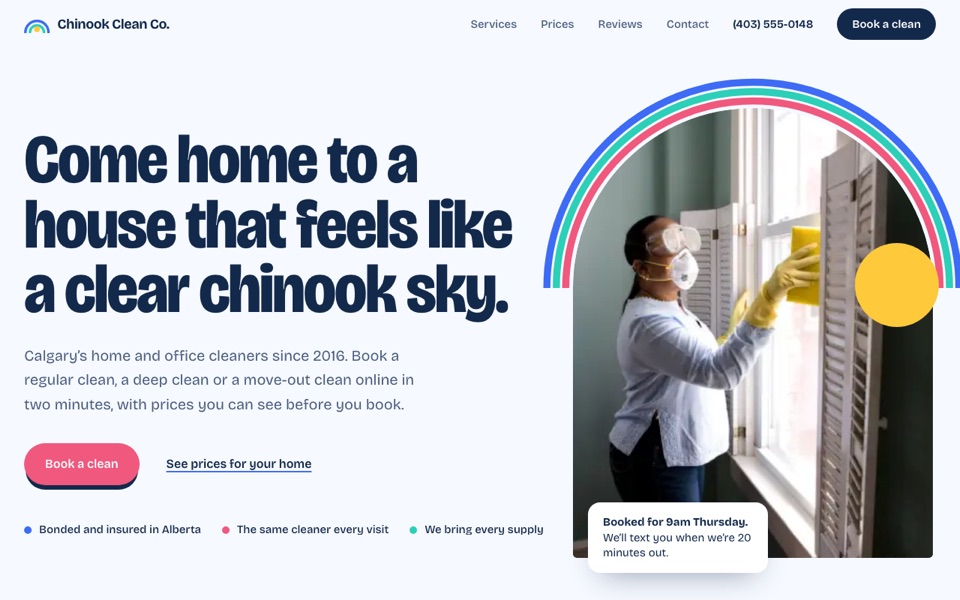
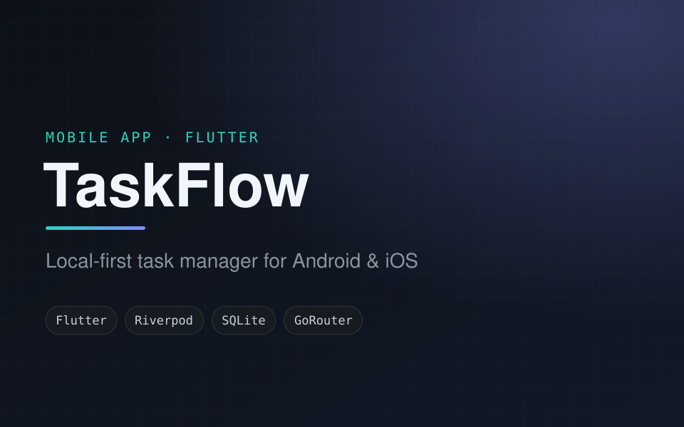
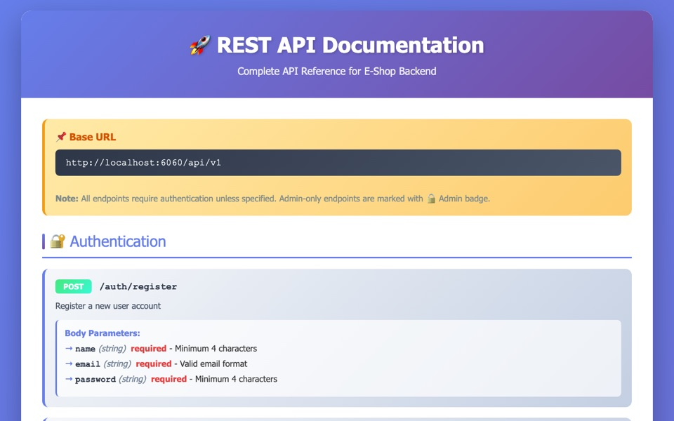
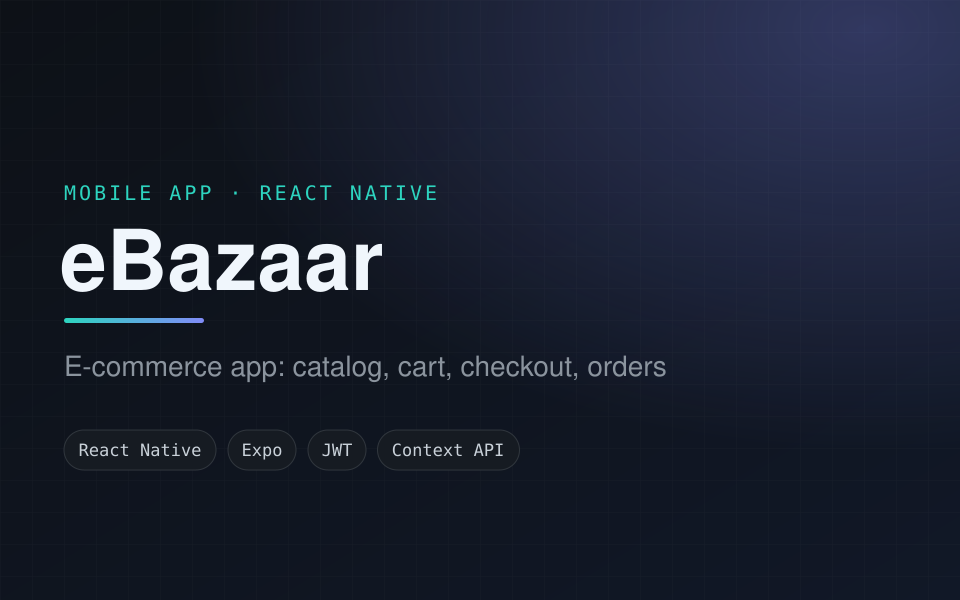
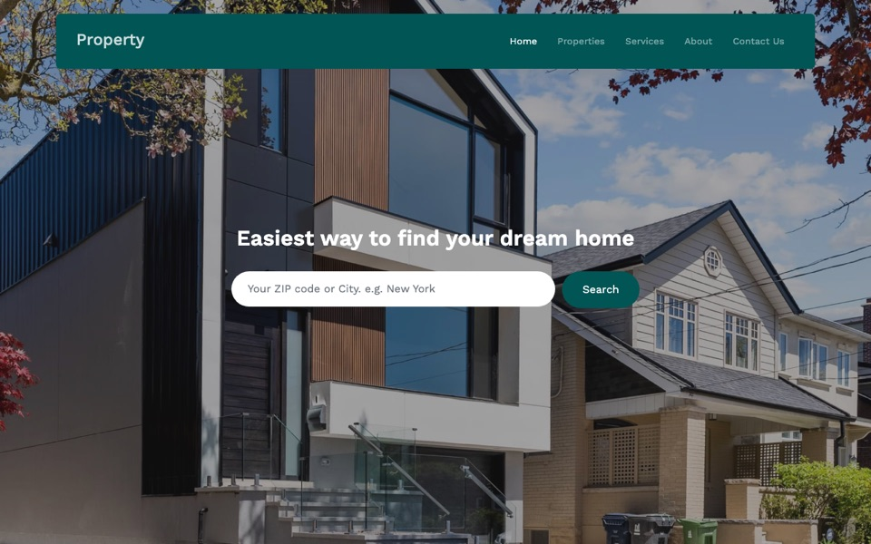
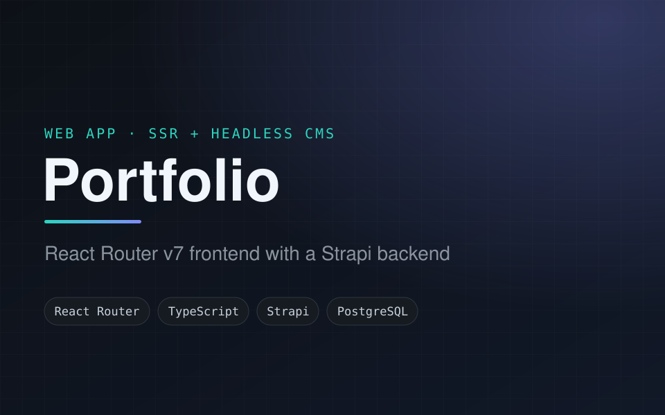

<!--
  GitHub profile README for @Munaa8805
  Theme: dark · accent #2dd4bf (teal) → #818cf8 (indigo) · surface #0d1117
  Edit tips:
    - Featured projects live in the "Featured Projects" table. Screenshots are in assets/projects/.
    - "Current Focus" is meant to change often.
    - Stats cards are third-party services; fallbacks are noted next to each one.
-->

  

  

  
  
  
  

  <a href="#about-me">About</a> ·
  <a href="#tech-stack">Stack</a> ·
  <a href="#featured-projects">Projects</a> ·
  <a href="#github-stats">Stats</a> ·
  <a href="#explore-my-repositories">Repositories</a> ·
  <a href="#current-focus">Focus</a> ·
  <a href="#connect-with-me">Connect</a>

 

## About Me

I'm a **full-stack developer in Calgary, Canada** who builds web apps, mobile apps, and the APIs behind them.

I started on GitHub in 2019 with small vanilla JavaScript projects like calculators, dice games and geolocation demos. From there I moved into **React** front ends, then **PHP and Laravel** applications, and later **Node.js/Express REST APIs** with JWT auth, file uploads, rate limiting and security middleware. Today I build end to end. I put a **Next.js or React** client on top of an API I wrote myself, and I ship **mobile apps with React Native (Expo) and Flutter**.

- **What I enjoy building:** e-commerce flows, booking and listing platforms, and productivity apps. These are products with real users, real data, and a clear "done."
- **How I work:** I write clean, layered code (controllers, models, routes; repositories and providers on mobile), I harden APIs by default, and I use AI-assisted tools like Claude Code to move faster without losing quality.
- **Where I'm heading:** I want to grow as a product-minded full-stack engineer who can take a feature from database schema to App Store build.

 

## Tech Stack

<table>
  <tr>
    <td width="190"><b>Languages</b></td>
    <td></td>
  </tr>
  <tr>
    <td><b>Frontend</b></td>
    <td></td>
  </tr>
  <tr>
    <td><b>Backend</b></td>
    <td>
       
      
      
      
    </td>
  </tr>
  <tr>
    <td><b>Mobile</b></td>
    <td>
       
      
      
      
    </td>
  </tr>
  <tr>
    <td><b>Databases</b></td>
    <td></td>
  </tr>
  <tr>
    <td><b>Tools &amp; Platforms</b></td>
    <td>
       
      
      
    </td>
  </tr>
</table>

 

## Featured Projects

<table>
  <tr>
    <td width="50%" valign="top">
      
      <h3>Chinook Clean Co.</h3>
      
Marketing and booking site for a Calgary home and office cleaning business. Visitors can compare services, see prices up front and book a clean in a couple of steps.

      
<code>Next.js 16</code> <code>React 19</code> <code>TypeScript</code> <code>Tailwind CSS v4</code> <code>Motion</code>

      

        <a href="https://calgarycleaningservices.vercel.app"><b>Live demo</b></a> ·
        <a href="https://github.com/Munaa8805/claude_projects/tree/main/calgary_cleaning_services">Source</a>
      

    </td>
    <td width="50%" valign="top">
      
      <h3>TaskFlow</h3>
      
Local-first task manager for Android and iOS. It has recurring tasks, categories, a calendar, progress statistics, local reminders, JSON/CSV export and Material 3 light/dark themes, with no account or server required.

      
<code>Flutter</code> <code>Dart</code> <code>Riverpod</code> <code>SQLite</code> <code>GoRouter</code> <code>fl_chart</code>

      

        <a href="https://github.com/Munaa8805/task_flow_app"><b>Source</b></a>
      

    </td>
  </tr>
  <tr>
    <td width="50%" valign="top">
      
      <h3>E-Shop REST API</h3>
      
E-commerce backend with JWT authentication, admin-only endpoints, request validation, image processing on upload, structured logging and rate limiting. Its documentation is hosted alongside it.

      
<code>Node.js</code> <code>Express</code> <code>MongoDB</code> <code>Mongoose</code> <code>JWT</code> <code>Sharp</code> <code>Socket.io</code> <code>Winston</code>

      

        <a href="https://restapi.munaa.dev"><b>API docs</b></a> ·
        <a href="https://github.com/Munaa8805/e-shop-restapi">Source</a>
      

    </td>
    <td width="50%" valign="top">
      
      <h3>eBazaar</h3>
      
E-commerce mobile app with product browsing, filtering and sorting by category, brand, price and rating, a cart, checkout, and order history. Sessions use token-based auth stored in SecureStore.

      
<code>React Native</code> <code>Expo</code> <code>React Navigation</code> <code>Context API</code> <code>Axios</code>

      

        <a href="https://github.com/Munaa8805/ebazaar-app"><b>Source</b></a>
      

    </td>
  </tr>
  <tr>
    <td width="50%" valign="top">
      
      <h3>Property Selling</h3>
      
Server-rendered real-estate listing site with property search, image uploads, and cookie-based JWT auth. Helmet, rate limiting, HPP, XSS and NoSQL-injection sanitization protect it.

      
<code>Node.js</code> <code>Express</code> <code>Pug</code> <code>MongoDB</code> <code>Multer</code> <code>JWT</code>

      

        <a href="https://property-selling-nine.vercel.app"><b>Live demo</b></a> ·
        <a href="https://github.com/Munaa8805/property-selling">Source</a>
      

    </td>
    <td width="50%" valign="top">
      
      <h3>Portfolio · React Router + Strapi</h3>
      
Portfolio site with server-side rendering, a project showcase with detail pages, an about page and a contact form. Content comes from a headless Strapi CMS backed by PostgreSQL, with Cloudinary handling media.

      
<code>React Router v7</code> <code>TypeScript</code> <code>Tailwind CSS</code> <code>Framer Motion</code> <code>Strapi</code> <code>PostgreSQL</code>

      

        <a href="https://github.com/Munaa8805/router-profile"><b>Frontend</b></a> ·
        <a href="https://github.com/Munaa8805/router-backend">CMS backend</a>
      

    </td>
  </tr>
</table>

 

## GitHub Stats

  <!-- Public instances can be rate-limited. If a card fails to load, deploy your own copy:
       github-readme-stats → https://github.com/anuraghazra/github-readme-stats#deploy-on-your-own
       streak-stats       → https://github.com/DenverCoder1/github-readme-streak-stats#-deploying-it-on-your-own -->
  
  

  

 

## Contribution Activity

  

<!-- Snake: generated daily by .github/workflows/snake.yml into the `output` branch. -->

  <picture>
    <source media="(prefers-color-scheme: dark)" srcset="https://raw.githubusercontent.com/Munaa8805/Munaa8805/output/github-snake-dark.svg" />
    <source media="(prefers-color-scheme: light)" srcset="https://raw.githubusercontent.com/Munaa8805/Munaa8805/output/github-snake.svg" />
    
  </picture>

 

## Explore My Repositories

More of my own work, grouped by what it shows. **[Browse all my original repositories →](https://github.com/Munaa8805?tab=repositories&type=source)**

<table>
  <tr>
    <th align="left" width="25%">Area</th>
    <th align="left">Repository</th>
    <th align="left">What it is</th>
  </tr>
  <tr>
    <td rowspan="3"><b>REST APIs</b></td>
    <td><a href="https://github.com/Munaa8805/natural-tour-restapi">natural-tour-restapi</a></td>
    <td>Tours API with JWT auth, Cloudinary uploads and scheduled jobs · <code>Express</code> <code>MongoDB</code></td>
  </tr>
  <tr>
    <td><a href="https://github.com/Munaa8805/twitter-backend">twitter-backend</a></td>
    <td>Backend for a Twitter-style app, paired with <a href="https://github.com/Munaa8805/twitter-frontend">twitter-frontend</a> · <code>Express</code> <code>Socket.io</code> <code>React</code></td>
  </tr>
  <tr>
    <td><a href="https://github.com/Munaa8805/laravel_restapi">laravel_restapi</a></td>
    <td>REST API built with Laravel · <code>PHP</code> <code>Laravel</code></td>
  </tr>
  <tr>
    <td rowspan="2"><b>Mobile</b></td>
    <td><a href="https://github.com/Munaa8805/book-app">book-app</a></td>
    <td>Book sharing app with auth, rated book feed and profiles · <code>React Native</code> <code>Expo Router</code></td>
  </tr>
  <tr>
    <td><a href="https://github.com/Munaa8805/shop-app">shop-app</a></td>
    <td>Shopping app built on Expo Router · <code>React Native</code> <code>TypeScript</code></td>
  </tr>
  <tr>
    <td rowspan="2"><b>Web apps</b></td>
    <td><a href="https://github.com/Munaa8805/pet-food">pet-food</a></td>
    <td>Pet food store with Firebase and Gemini AI features · <code>React</code> <code>TypeScript</code> <code>Firebase</code></td>
  </tr>
  <tr>
    <td><a href="https://github.com/Munaa8805/claude_projects">claude_projects</a></td>
    <td>Apps built with AI-assisted workflows: calorie tracker, car marketplace, electronics store and more · <code>Next.js</code></td>
  </tr>
  <tr>
    <td><b>PHP</b></td>
    <td><a href="https://github.com/Munaa8805/iwork-v2">iwork-v2</a></td>
    <td>Laravel 11 web application · <code>PHP</code> <code>Laravel</code> <code>Tailwind CSS</code></td>
  </tr>
</table>

 

## Current Focus

<!-- Update this section whenever your focus changes. -->

- **Building:** cross-platform mobile apps in **Flutter**, with Riverpod for state, SQLite for offline storage and GoRouter for navigation
- **Leveling up:** **Next.js 16 / React 19** with TypeScript across the whole stack
- **Exploring:** AI-assisted development with **Claude Code** and integrating LLM APIs (Gemini) into apps
- **Next up:** automated testing and CI with GitHub Actions on my main projects

 

## Connect With Me

  I'm open to full-stack, front-end and mobile roles, freelance work and collaborations. 
  The fastest way to reach me is email or LinkedIn.

  
  
  
  

  

